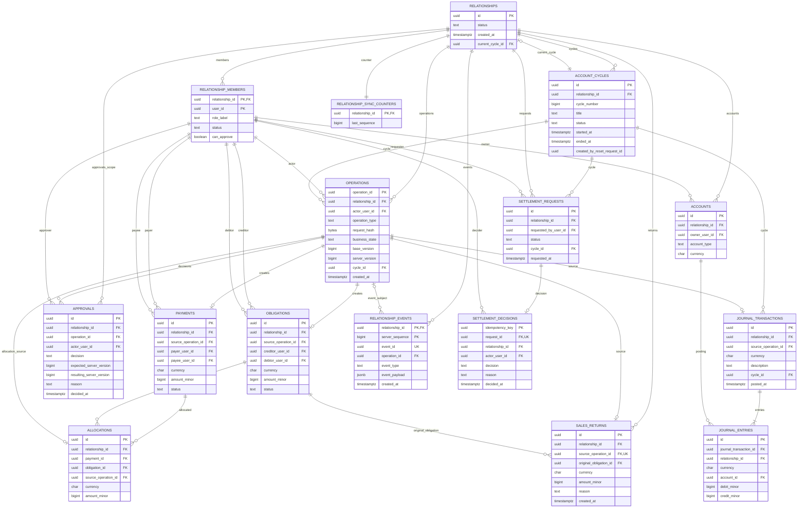
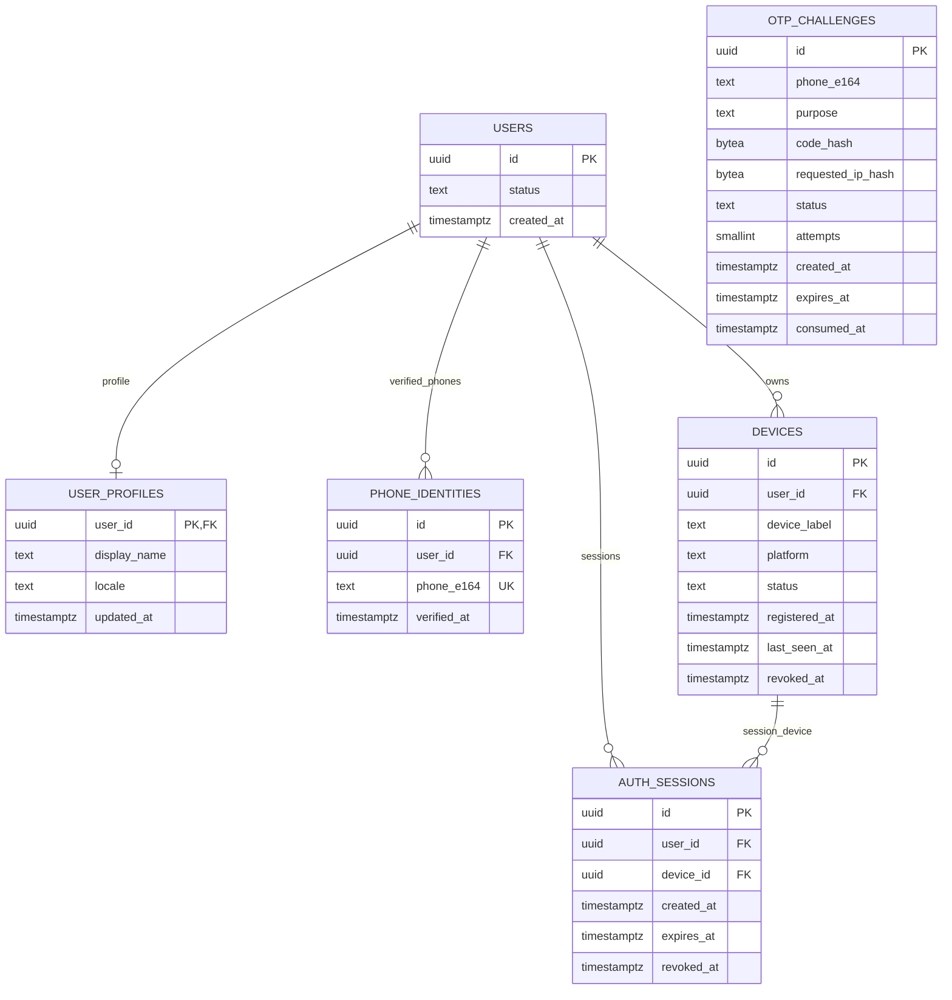
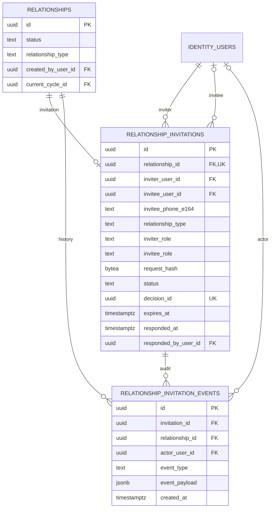

# مخطط قاعدة البيانات ERD — الدفتر التجاري المشترك

**الحالة:** مخطط as-built لـ ledger migrations 001–009 وidentity migration 010 وrelationship migration 011؛ لا يخلط الجداول المنفذة بالكيانات المستقبلية.  
**المراجعة:** 2026-11-02 | **قاعدة الاختبار:** PostgreSQL 16، CI Run #131.

> معرفات المستخدمين خارجية في هذه النسخة؛ لا يوجد جدول users ضمن schema ledger. الرسم يعرض الجداول الفعلية فقط.

## 1. مخطط ERD

## 2. مسؤولية الجداول

| الجدول | المسؤولية |
|---|---|
| relationships | العلاقة التجارية ومؤشر الدورة الحالية |
| relationship_members | عضوية العلاقة والدور وصلاحية الاعتماد |
| operations | أوامر الأعمال وحالتها وإصداراتها ودورتها |
| approvals | قرارات اعتماد/رفض العمليات |
| obligations | أصل المستحق والدائن والمدين |
| payments | الدفعات المسجلة |
| allocations | تخصيص دفعة إلى التزام |
| accounts | حسابات الأستاذ المساعدة لكل طرف/نوع/عملة |
| journal_transactions | رأس القيد ومصدره |
| journal_entries | الأسطر المدينة والدائنة |
| relationship_sync_counters | عداد تسلسل أحداث العلاقة |
| relationship_events | سجل أحداث المزامنة |
| settlement_requests | طلب التصفير |
| settlement_decisions | قرار الطرف المقابل |
| account_cycles | صفحات الحساب الحالية والمؤرشفة |
| sales_returns | المرتجعات المعتمدة المرتبطة بالتزام أصلي؛ immutable ويُنشئ قيدًا عكسيًا |

## 3. قيود لا يظهرها الرسم وحده

- المفاتيح المركبة تربط السجلات بالعلاقة نفسها، وتمنع مراجع عابرة للعلاقات.
- أسطر القيد مرتبطة برأس القيد والحساب وبالعملة والعلاقة ذاتها.
- تخصيص الدفعة يخضع للتحقق من الأطراف والعملة والمبالغ المتبقية؛ migration 008 يمنع تخصيصًا بين دورتين.
- العمليات والقيود وطلبات التصفير تحمل cycle_id. لكل علاقة دورة نشطة واحدة، وrelationships.current_cycle_id يشير إلى الحالية.
- operation_id في relationship_events يقبل NULL لأحداث التصفير.
- السجلات المالية وأحداث/قرارات محددة محمية من UPDATE/DELETE بواسطة triggers. سجل المرتجعات sales_returns منفذ في migration 009 ومحصن من UPDATE/DELETE؛ لا يعني ذلك اكتمال واجهة مرتجع أو رد نقدي مستقل أو سير عمل عام لعكس كل أنواع الدفعات والتخصيصات.

## 4. ما ليس موجودًا كجداول في migrations 001–009

لا توجد جداول ledger للمستخدمين/OTP، الأجهزة والجلسات، المرفقات، سياسات الموافقة المستقلة، سجل تدقيق أمني منفصل، أو outbox وsync cursor المحليين (هذه ضمن طبقة الهاتف). لا ترسم هذه كجداول منفذة قبل إضافة migrations.

## 5. مصدر الحقيقة والاختبار

- المصدر: migrations 001–009 داخل db/migrations.
- الاختبارات: db/tests/001 إلى 005 و007.
- Workflow: .github/workflows/ledger-db-tests.yml.
- دليل PostgreSQL 16: [CI Run #94](https://github.com/overurdream-collab/test4/actions/runs/41424042840).
- لا توجد قاعدة إنتاجية أو نشر ضمن هذا العمل.

**تحديث بعد PR #25–#28:** أضيفت sales_returns في migration 009، وأصبح API يعرض partyBalanceMinor بإشارة موجبة/سالبة لكل طرف. PostgreSQL Run #131 وApproval API Run #66 ناجحان. راجع ملف التسليم لأرقام SHA وروابط التشغيل.

**تنبيه:** الرسم يوضح الكيانات وروابطها. ملفات SQL هي المرجع النهائي لأنواع القيود المركبة وCHECK والفهارس وtriggers.

## 6. مخطط الهوية والأجهزة — migration 010

الجداول التالية منفذة في schema منفصل باسم `identity`، وليست جزءًا من دفتر `ledger`:

| الجدول | المسؤولية |
|---|---|
| identity.users | حساب المستخدم الموحد وحالته |
| identity.phone_identities | أرقام الهاتف الموثقة؛ الرقم الواحد لحساب واحد |
| identity.user_profiles | الاسم الظاهر واللغة |
| identity.devices | الأجهزة النشطة أو الملغاة |
| identity.auth_sessions | جلسات access token قصيرة العمر، مرتبطة بالمستخدم والجهاز |
| identity.otp_challenges | تحديات OTP؛ يخزن HMAC digest لا الرمز النصي |

### حدود الربط الحالية
- `identity.users.id` هو معرف الحساب الذي يعيده مسار OTP.
- جداول `ledger.relationship_members.user_id` لا تحمل حتى الآن FK مباشرًا إلى `identity.users`؛ هذا مقصود مؤقتًا للحفاظ على بيانات/اختبارات ledger السابقة التي استخدمت معرفات خارجية. يجب أن ينشئ مسار العلاقات عضوية بمعرف حساب موثق، ثم يمكن إضافة قيد FK بعد ترحيل/مطابقة البيانات بأمان.
- لا توجد بعد جداول دعوات/طلبات ربط العلاقات في migration 010.
- لا يوجد مزود SMS فعلي أو refresh token؛ لا تعتبر وجود OTP adapter مصادقة إنتاجية مكتملة.

## 7. مخطط العلاقات والدعوات — migration 011

| الجدول | المسؤولية |
|---|---|
| ledger.relationship_invitations | طلب ربط واحد لعلاقة v1، مرتبط بالهاتف الموثق، مع idempotency وقرار القبول/الرفض |
| ledger.relationship_invitation_events | سجل أحداث غير قابل للتعديل/الحذف لإنشاء الدعوة والقبول والرفض والانتهاء |

### قيود العلاقة الجديدة
- تنشأ العلاقة بحالة `suspended` وبطرف نشط واحد؛ لا تقبل عمليات مالية.
- قبول الدعوة يتطلب حسابًا نشطًا ورقم هاتف موثقًا يطابق رقم المدعو، ثم تصبح العلاقة `active` بطرفين نشطين.
- الرفض أو انتهاء الدعوة يغلق العلاقة المعلقة.
- migration 011 يمنع أكثر من طرفين نشطين ويمنع إدخال عملية مالية ما لم يوجد طرفان نشطان.
- لم يضف FK مباشرًا من `ledger.relationship_members.user_id` إلى `identity.users.id` للحفاظ على معرفات السجلات القديمة؛ دالة إنشاء العلاقة تتحقق من الهوية قبل إنشاء العضوية الجديدة.
